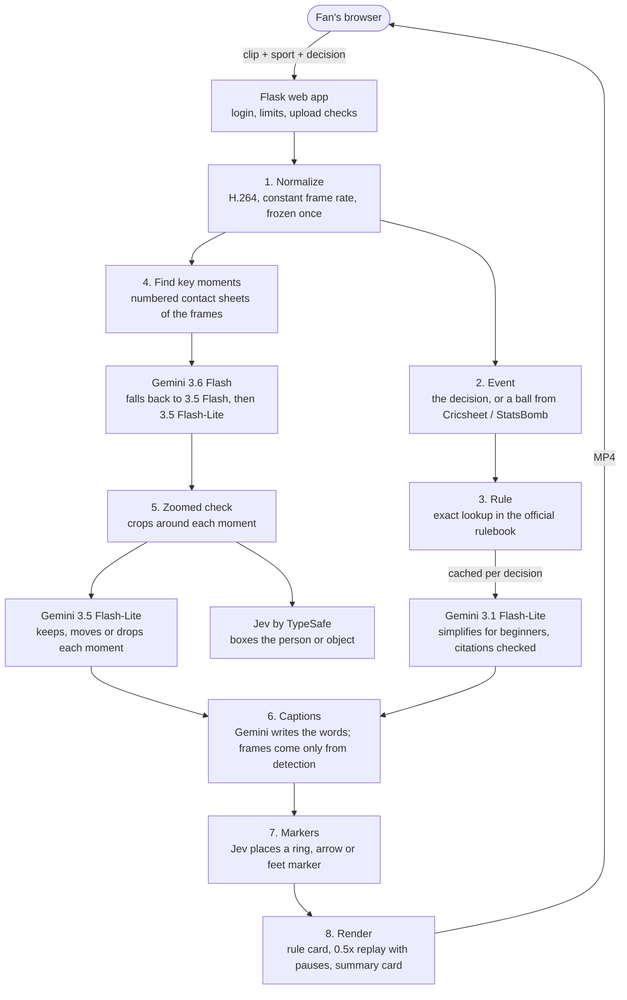

# Wait, Why?

**An AI explainer for officials' decisions in live sport.** A fan sees the umpire's finger go up, the offside flag,
the charge call, the "out" from the line judge, but not the reason. Give **Wait, Why?** a clip of the call and it
returns a short video that explains it for a beginner:

1. **The rule, in plain words**, taken from the official rulebook and cited by section.
2. **The moment again at half speed**, pausing at each key point (ball released, ball hits the pad, umpire signals),
   with a caption saying what happens and a marker on the action.

It works for **cricket, football, basketball and tennis**: 75 decisions in all, from LBW and no balls to offside,
charging, foot faults and electronic line calls.

**Live app:** https://why-this-decision.onrender.com (password-protected; the password is shared with evaluators
separately). Everything runs live: each clip is analysed when you press the button, nothing is precomputed. A run
takes about 2 to 4 minutes on the free server.

---

## Contents

- [The problem](#the-problem)
- [How a fan uses it](#how-a-fan-uses-it)
- [System architecture](#system-architecture)
- [The pipeline, stage by stage](#the-pipeline-stage-by-stage)
- [How we got here: what we tried](#how-we-got-here-what-we-tried)
- [Running it online for free](#running-it-online-for-free)
- [Sports and decisions](#sports-and-decisions)
- [Repository layout](#repository-layout)
- [Run it locally](#run-it-locally)
- [Limits](#limits)
- [AI tools used](#ai-tools-used)

---

## The problem

Officials' calls decide matches, but broadcasts show the outcome, not the reasoning. Replays loop the moment without
saying which rule applies or what to look for, and the rules themselves are long legal texts. Newer fans can't tell
why a batter was out LBW, why a goal was ruled offside or why a dunk became a charge, so the call feels arbitrary and
they lose trust in it.

## How a fan uses it

1. Open the app and log in.
2. **Add the clip:** upload an MP4, or press **Select from here** and pick one of 19 ready clips. Each clip can be
   previewed with **Watch** before choosing.
3. **Sport** and **decision:** pick the sport and the call (or, for cricket and football, let the match data name it).
4. Press **Explain this decision** and keep the page open. Progress shows stage by stage.
5. The result plays on the page and can be downloaded: a rule card, the slowed replay with pauses and captions, and
   a summary card.

---

## System architecture



**Two rules hold everywhere:**

- **The AI never invents a frame or a citation.** Gemini may only answer with a frame number printed on the images it
  was sent, and the rule text may only cite sections that were actually retrieved. Anything else is rejected.
- **Every stage fails gently.** If the rule can't be simplified, the official text is shown. If the zoomed check
  fails, the first answers stand. If captions fail, plain labels are used. If a marker isn't confident, there is no
  marker. The fan still gets a replay.

Only the inputs are sport-specific: each sport has its own folder with its decisions, prompts, rulebook and marker
targets (`V9/sports/<sport>/`). The pipeline, the web app and the renderer are shared.

---

## The pipeline, stage by stage

| # | Stage | What happens | Code |
|---|---|---|---|
| 1 | **Normalize** | A clip already in H.264, yuv420p, constant frame rate is kept untouched; otherwise it is re-encoded **once** and then frozen. Frame numbers (0-based) depend on this clip, so it is never encoded again. | `pipeline/normalize.py` |
| 2 | **Event** | The decision chosen on the page, or one ball read from a Cricsheet file (cricket) or one event from StatsBomb / SoccerNet data (football), turned into the same sport-neutral event record. | `sports/<sport>/events.py` |
| 3 | **Rule** | The decision maps to exact sections of the official rulebook (the edition picked by match date). Gemini 3.1 Flash-Lite rewrites them for beginners as a summary, conditions and exceptions; each citation is checked against the retrieved sections. One AI call per decision ever, then cached. | `pipeline/rules.py` |
| 4 | **Find key moments** | The clip's frames are laid out as numbered contact sheets (4 × 3 frames, every 2nd frame, more on long clips). Gemini names the frame of each moment the decision needs (for LBW: release, ball pitches, ball hits pad, appeal, umpire's signal). Long clips get a second, finer pass around the first answers. Moments the logic can work out are derived, not detected (bat misses ball = stumps hit − 1 for bowled). | `pipeline/detect.py` |
| 5 | **Zoomed check** | For each moment, 7 frames around the answer are cropped around the person or object (boxed by Jev) and enlarged. Gemini keeps, moves or removes the moment. | `pipeline/verify.py` |
| 6 | **Captions** | Gemini writes a title and caption for each moment from the event, the rule and the detections. Frames only ever come from detection; any frame the model writes is ignored. | `pipeline/plan.py` |
| 7 | **Markers** | Jev boxes what each moment is about (the bowler, the pad, the referee, the server's feet). A marker is drawn only when Jev's own presence score is high enough. | `pipeline/spotlight.py` |
| 8 | **Render** | ffmpeg builds the MP4: rule card, the replay at 0.5x from 3 s before the first moment to 2 s after the last, a 3 s pause with caption and marker at each moment, a timeline with moment dots, and a summary card. | `pipeline/render.py` |

**Model order.** Each AI step has its own model list, set on the host without code changes:

| Step | Models, in order | Setting |
|---|---|---|
| Find key moments, pass 1 | Gemini 3.6 Flash → 3.5 Flash → 3.5 Flash-Lite | `DETECT_MODELS_PASS1` |
| Find key moments, pass 2 | Gemini 3.5 Flash-Lite | `DETECT_MODELS_PASS2` |
| Zoomed check | Gemini 3.5 Flash-Lite | `CHECK_MODELS` |
| Rule text, captions | Gemini 3.1 Flash-Lite → 3.5 Flash-Lite | `TEXT_CHAIN` in `config.py` |

A busy or out-of-quota model moves the step to the next one, so a run doesn't fail because one model is unavailable.

---

## How we got here: what we tried

The hard part is **timing**: finding the exact frame where the ball hits the stumps or the pad, in broadcast video
with camera cuts and zooms. Frame-perfect isn't required (the replay is at 0.5x with pauses), but within 1 to 2
frames is. On the main test clip the stumps are hit at frame 17.

| Approach | Result |
|---|---|
| Hand-written pixel rules (motion in a fixed stumps region, pose "wrist above nose", a COCO "sports ball" detector) | Failed: the camera zooms and pans, pose picked the wrong people, ball detections were noise |
| Camera compensation (SIFT homography) | Partial: the box followed the stumps but gave a broad motion bump, not a hit |
| Fine-tuning YOLO on public datasets | Parked: no dataset labels "stumps broken" |
| Jev on single frames, grids and crops | Good for boxing people, unreliable for the ball, bails and exact timing |
| Gemma 4 (open model) | Dropped: every image request was refused through the API |
| **Gemini on numbered contact sheets** | **Best:** stumps 16 or 18 (truth 17), release stable. This became the timing layer |

Then, model by model on the same clips: Gemini 3.6 Flash gave the best frames (stumps 16 on the bowled clip);
3.5 Flash-Lite is the fastest but was 8 to 10 frames late there (stumps 25 to 28). That is why 3.6 Flash leads the
order and Flash-Lite is the fallback. Two more layers were added on top: a finer second pass for long clips, and the
zoomed check on crops. Full test results are in `V9/RESULTS.md`.

Each version is in the git history: V1 (cricket demo) → V2 (multi-sport layout) → V3 (zoomed check) → V4 (basketball,
tennis, SoccerNet) → V5 (Jev markers) → V6 → V7 (two-pass detection, model order) → V8 / V9 (made safe and small
enough to run online).

---

## Running it online for free

Hugging Face now charges for Docker apps, so the app runs on **Render's free plan**: 512 MB of memory and a tenth of
a CPU. Getting the pipeline to fit took several changes:

| Problem | What we did | Result |
|---|---|---|
| Out of memory: every full-HD frame was held at once | Frames are read only when a stage needs them (`pipeline/frames.py`); freed memory is handed back between stages | 2.3 GB → under 300 MB per run, whatever the clip length |
| Render was slow on 0.1 CPU | Each slow-motion frame is written once at half the frame rate (same picture timing, half the frames); faster encoder setting; fonts loaded once; output at 720p (detection still uses full size) | Render step 112 s → 53 s |
| YouTube blocks cloud servers | The 19 library clips are packed with the app (`pack_clips.py`), so the server never downloads from YouTube | Clips load in under a second |
| Server sleeps after 15 idle minutes | It pings its own health check every 14 minutes (`KEEP_AWAKE_MINUTES`), no AI call | Stays awake |

**Security, since it's on the open internet:**

- A password on every page, with a lockout after 5 wrong tries.
- A token from the page on every form post, the login included.
- A strict content policy, so only the page's own script can run.
- Uploads: at most 300 MB, 1080p and 2 minutes, and they must read as real video.
- Daily limits: 10 runs a day in total and 3 per login, to protect the free Gemini quota.
- Each visitor sees only their own results. Their clip, output and job files are deleted when they leave or
  refresh the page, when the server stops, or 30 minutes after the video is made.
- API keys live only in the host's settings, never in the code.

**Operations:** a phone or e-mail alert when Gemini 3.6 Flash runs out of quota (`pipeline/notify.py`, via ntfy),
one log line per run with each stage's time, and a usage report (`V9/usage_report.py`) counting page views, visitors,
runs and outcomes from the server log.

---

## Sports and decisions

| Sport | Rulebook | Decisions | Examples |
|---|---|---|---|
| Cricket | MCC Laws of Cricket (2022 and 2026 editions, picked by match date) | 24 | Bowled, LBW, run out, stumped, no ball (front foot), wide, DRS review |
| Football | IFAB Laws of the Game 2026/27 | 16 | Goal, offside, penalty, handball, second yellow, VAR check |
| Basketball | NBA Official Playing Rules 2026-27 | 21 | Traveling, goaltending, charging, blocking foul, shot clock |
| Tennis | Rules of Tennis 2026 | 14 | Service fault, foot fault, ball out, electronic line review |

Match data is optional: Cricsheet for cricket, StatsBomb or SoccerNet for football. Adding a sport means adding a
folder under `V9/sports/` with its decisions, rulebook and prompts; the rest of the system is unchanged.

---

## Repository layout

| Path | What it is |
|---|---|
| [`V9/`](V9/) | The app: web page, pipeline, sports, tests. **Setup and settings in [`V9/README.md`](V9/README.md)** |
| `V9/app.py` | Web app: login, limits, upload checks, jobs, temporary files, usage lines, keep-awake |
| `V9/pipeline/` | The eight stages above, plus `frames.py` (reads frames as needed) and `notify.py` (quota alert) |
| `V9/sports/<sport>/` | Per sport: decisions and prompts, event adapters, rulebook (original PDF + parsed sections), marker targets |
| `V9/clips/` | The 19 library clips packed with the app |
| `V9/tests/` | 418 unit tests (no real clips, no AI calls) |
| [`render.yaml`](render.yaml) | Deploys `V9/` to Render's free plan |
| [`ARCHITECTURE.md`](ARCHITECTURE.md) | The original design the build followed |
| `videos/` | Source clips used while developing |
| `tests/` | The early experiments from the table above, kept for reference |

## Run it locally

You need Python 3.12, ffmpeg, and a `GEMINI_API_KEY` in a `.env` file next to `V9/` (optionally `TYPESAFE_API_KEY`
for markers). From `V9/`:

```
pip install -r requirements.txt
python app.py
```

Open http://127.0.0.1:5002. Locally there is no password and no limits, and job folders are kept. Unit tests:
`pip install pytest`, then `python -m pytest tests -q`.

## Limits

- **Free-tier speed:** a run takes about 2 to 4 minutes, mostly waiting for Gemini. Busy periods add time.
- **Free quota:** Gemini 3.6 Flash allows about 20 requests a day per Google project; after that runs use the
  fallback models, with rougher timing. The quota resets at about 13:30 IST.
- **Timing:** usually within 1 to 2 frames on clear footage; tiny or hidden things (the ball, a bail behind the batter,
  a tennis ball's landing) are the weakest.
- **What the clip doesn't show, the app can't explain:** a spoken call or a decision made off camera gets the rule
  card and a plain replay.
- **No sound** in the output video.

## AI tools used

- **Gemini 3.6 Flash, 3.5 Flash, 3.5 Flash-Lite** (Google): find and check the key moments in the video.
- **Gemini 3.1 Flash-Lite** (Google): simplifies the official rules and writes the captions.
- **Jev** (TypeSafe): locates people and objects for the zoomed check and the markers.
- **Claude Code** (Anthropic): helped build, test and deploy the system.
